# 🔐 PDF Password Recovery Lab — Dictionary Attack & John the Ripper

**NetworkWalks Cybersecurity Lab | November 18, 2026**

## ⚖️ Liability Disclaimer

This is a documentation of an educational, authorized password-recovery exercise using lab-provided PDF files. I did not test third-party documents. Password recovery should only be attempted on files you own or have explicit permission to assess.

## 📖 Introduction

In this activity, I learned how password-protected PDFs can be tested through offline dictionary-based password recovery. I practiced two separate methods: **Johnny**, a graphical interface for John the Ripper, and the **NetworkWalks web-based Password Cracker**.

I checked each recovered password by opening its corresponding PDF in PDF X.

These are two different PDFs with different passwords and flags. The screenshots document two separate demonstrations.

## 🎯 Objectives

- Identify a password-protected PDF and extract its password hash.
- Use Johnny and John the Ripper to test a PDF hash.
- Use the NetworkWalks dictionary-attack lab with a different PDF hash.
- Verify recovered passwords by opening the corresponding PDFs.
- Document the process with screenshots and explain the results.

## 🧰 Tools Used

| Tool | Purpose |
|---|---|
| PDF X | Open protected PDFs and verify passwords |
| Online HashCrack | Extract the PDF password hash |
| Johnny | Graphical interface for John the Ripper |
| John the Ripper 1.9.0-jumbo-1 | Password-recovery engine |
| NetworkWalks Password Cracker | Perform a web-based dictionary attack |
| Google Chrome | Access the online lab tools |
| Windows | Operating environment |

## 🖥️ Lab Environment

| Item | Setup |
|---|---|
| Operating System | Windows |
| PDF Viewer | PDF X |
| Password Recovery Tool | Johnny / John the Ripper |
| First PDF | My Locked PDF1.pdf |
| Second PDF | My-Locked-PDF1.pdf |
| First Recovered Password | `good-luck` |
| Second Recovered Password | `password1` |

---

## 🪜 Lab Procedure

### Task 1 — PDF Password Recovery Using Johnny (John the Ripper)

### Step 1. Open the Password-Protected PDF

I opened the PDF file using PDF X. The application asked for a password before allowing me to view the document.

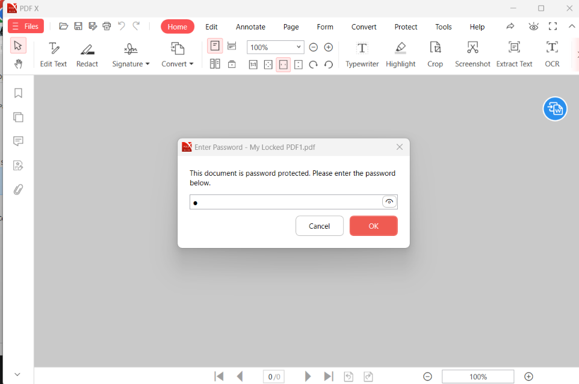

### Step 2. Upload the PDF to the Hash Extractor

I used the Online HashCrack PDF Hash Extractor and selected my password-protected PDF file.

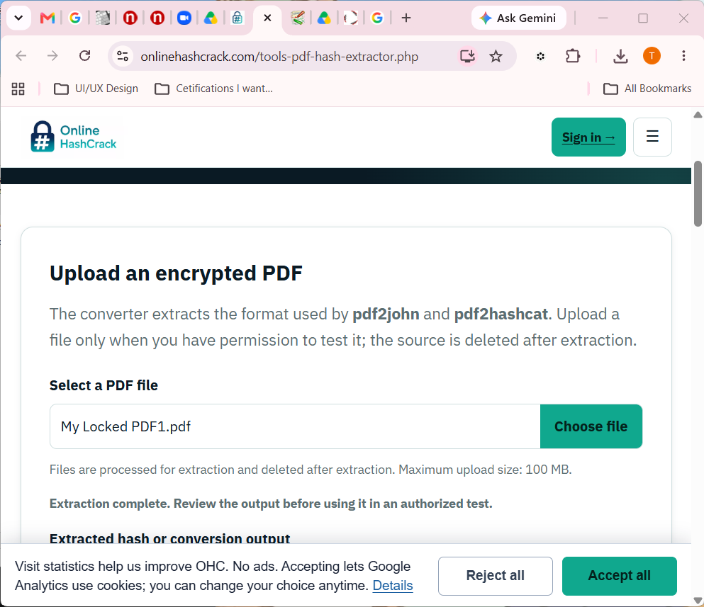

### Step 3. Extract the PDF Hash

After uploading the PDF, the website generated a hash beginning with `$pdf$`.

The extracted hash would be used for password recovery.

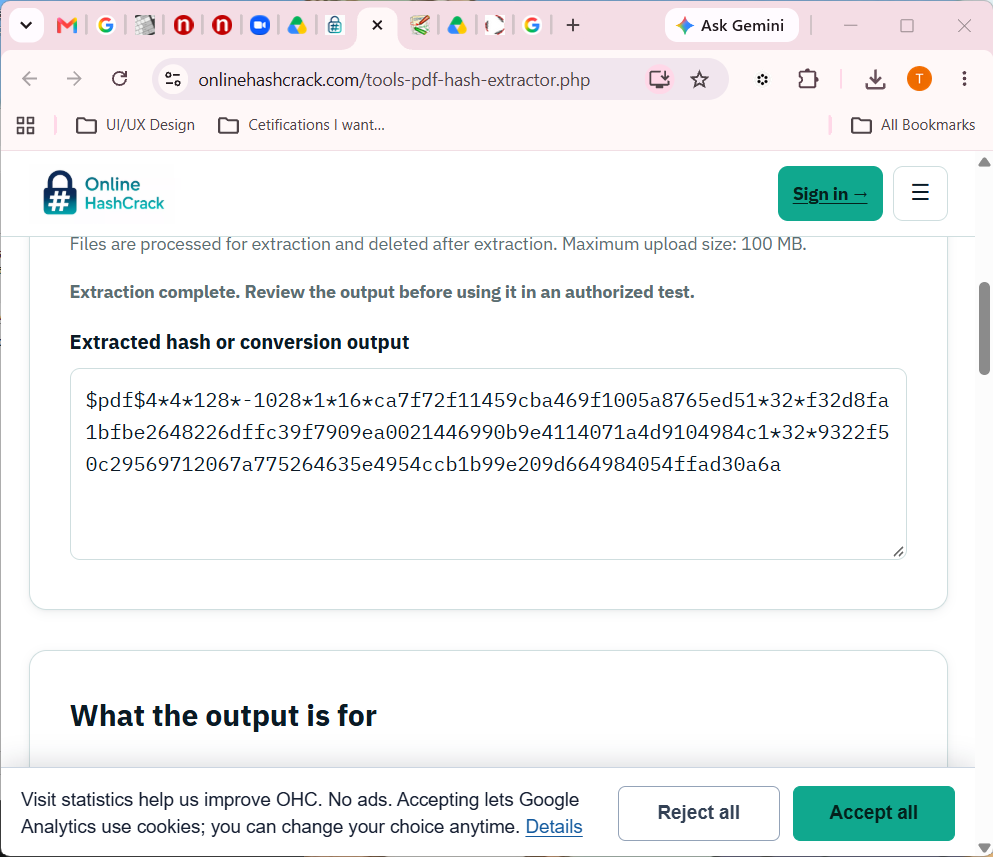

### Step 4. Import the Hash into Johnny

I opened Johnny, the graphical interface for John the Ripper.

I selected the file-import option to load the PDF hash into the application.

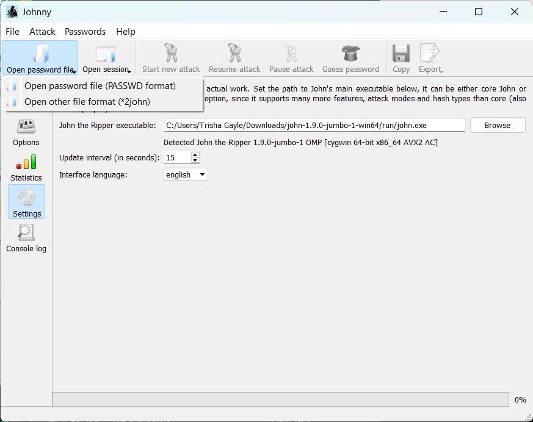

### Step 5. Check the Imported Hash

Johnny successfully recognized the PDF hash.

At this stage, the program showed that one password remained to be recovered.

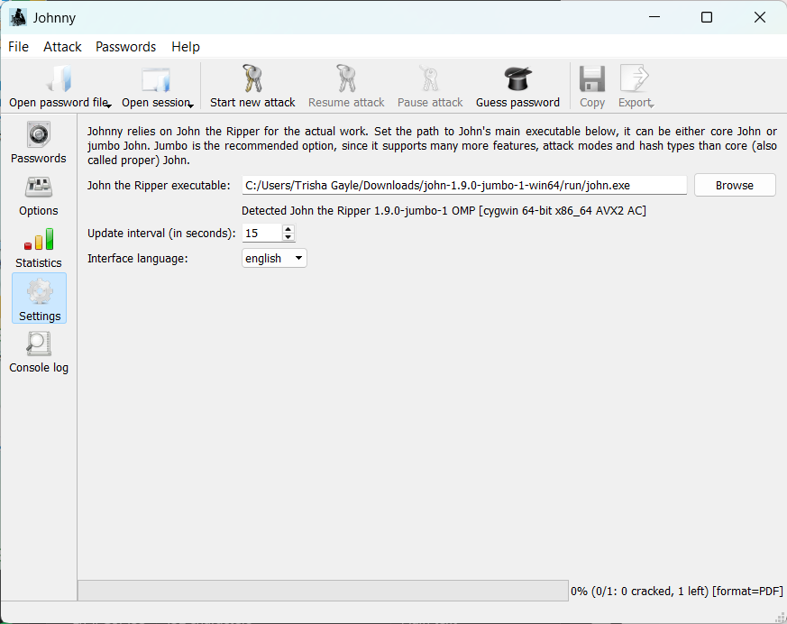

### Step 6. Start the Password Recovery Attack

I started the password recovery process using Johnny.

After completing the attempt, the application displayed:

- 1 password cracked
- 0 passwords remaining
- 100% completion

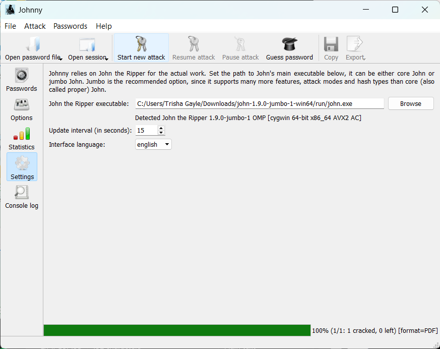

### Step 7. View the Recovered Password

I opened the Passwords tab in Johnny to check the result.

The recovered password was:

`good-luck`

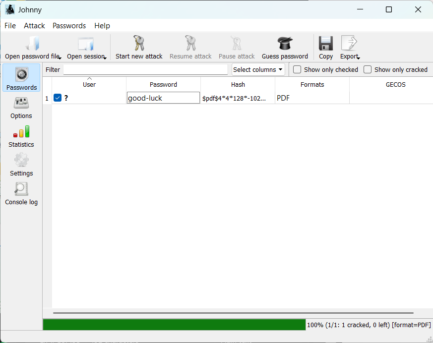

### Step 8. Confirm the Recovery Result

I checked the final Johnny results to verify that the password was successfully recovered.

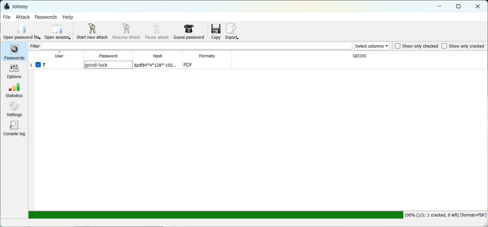

### Step 9. Enter the Recovered Password

I returned to PDF X and entered the recovered password, `good-luck`, into the password field.

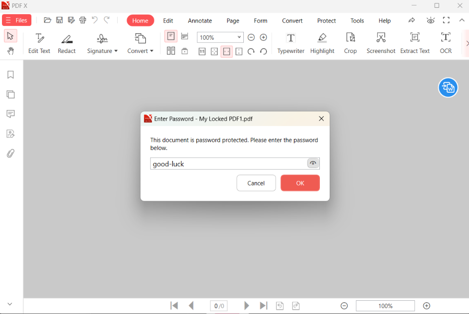

### Step 10. Verify the Unlocked PDF

The PDF opened successfully and displayed the NetworkWalks congratulations page.

The document also contained the first captured flag.

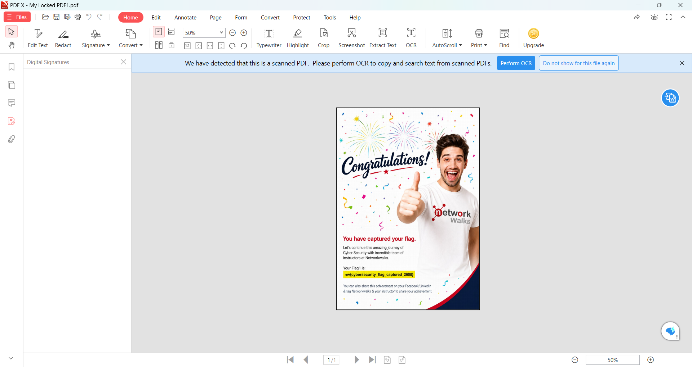

**Result:** Successfully recovered the PDF password using Johnny and John the Ripper.

---

### Task 2 — PDF Password Recovery Using NetworkWalks Dictionary Attack

### Step 11. Open the NetworkWalks Password Cracker

For the second activity, I used the NetworkWalks online Password Cracker.

The website provides a dictionary-attack tool that tests passwords from a wordlist against a PDF hash.

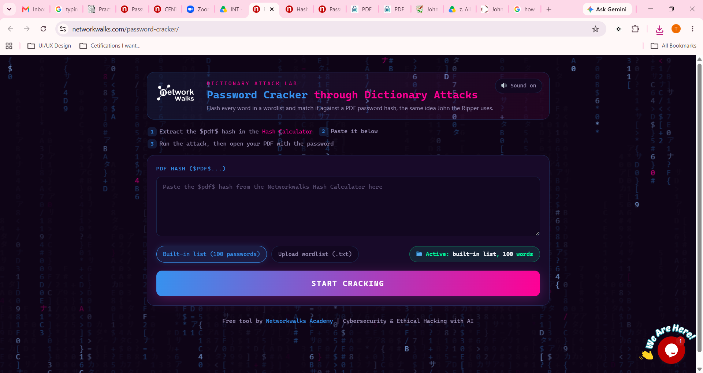

### Step 12. Paste the PDF Hash

I entered the extracted hash of the second password-protected PDF into the website.

I selected the built-in dictionary containing 100 passwords.

### Step 13. Start the Dictionary Attack

I clicked the Start Cracking button and observed the website testing different passwords from its wordlist.

After several attempts, the website successfully identified a matching password.

**Recovered password:** `password1`

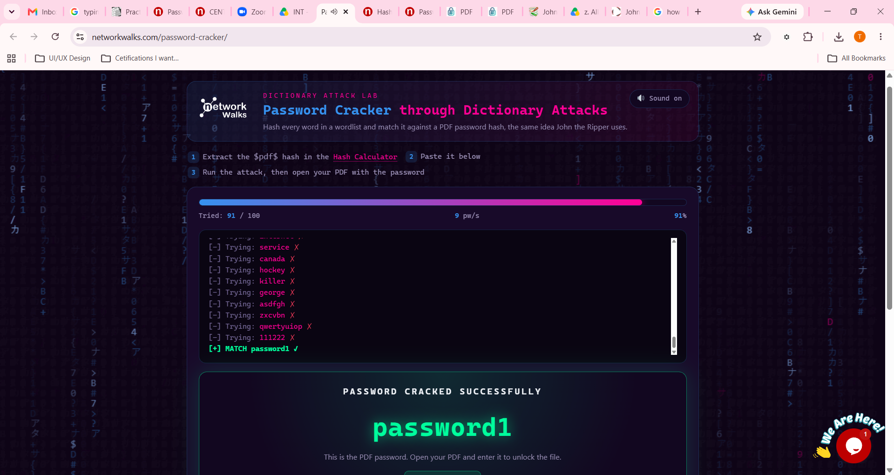

### Step 14. Verify the Password in PDF X

I opened the second protected PDF using the recovered password.

The document opened successfully and displayed another NetworkWalks congratulations page and captured flag.

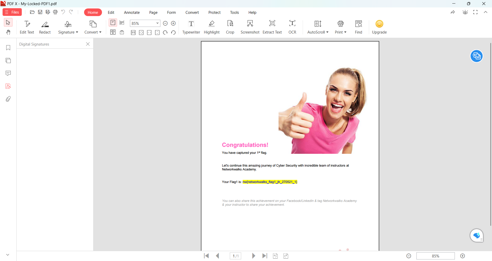

**Result:** Successfully recovered the second PDF password using the NetworkWalks dictionary-attack tool.

---

## 🔎 Lab Verification

I verified the results of both exercises by entering the recovered passwords into their corresponding PDF files.

| Test | Result |
|---|---|
| First PDF Password Protection | Confirmed |
| PDF Hash Extraction | Successful |
| Johnny Password Recovery | Successful |
| Johnny Recovered Password | `good-luck` |
| First PDF Verification | Successfully Unlocked |
| NetworkWalks Dictionary Attack | Successful |
| Second Recovered Password | `password1` |
| Second PDF Verification | Successfully Unlocked |

Both activities were completed successfully.

## 🐞 Challenges and Observations

During the activity, I observed that the extracted PDF hash was different from the actual password. The hash needed to be processed by a compatible password-recovery tool.

I also noticed that Johnny initially displayed zero cracked passwords. After starting the recovery process, the application successfully identified the password.

Another observation was that both password-recovery tools produced different results because I was testing two separate PDF files.

I confirmed the recovered passwords by opening the documents rather than relying only on the results displayed by the tools.

## 💡 What I Learned

Through this lab, I learned:

1. How password protection works with PDF documents.
2. How to extract a PDF hash for password-recovery testing.
3. How to use Johnny and John the Ripper for password recovery.
4. How dictionary attacks test passwords against extracted hashes.
5. How to verify recovered passwords by opening protected documents.
6. Why strong and unpredictable passwords are important for protecting files.

This activity helped me understand how password-recovery tools work and why weak passwords can make protected documents vulnerable to dictionary attacks.

## 🔐 Security and Ethical Use

This activity was performed for educational purposes using authorized lab files.

Password-recovery tools should only be used on documents or systems that you own or have permission to test.

Strong passwords and proper file protection can help prevent unauthorized access to sensitive information.

## 🔗 Tools and Resources

- [NetworkWalks Password Cracker](https://networkwalks.com/password-cracker/)
- [Online HashCrack PDF Hash Extractor](https://www.onlinehashcrack.com/tools/pdf-hash-extractor.php)
- [John the Ripper](https://www.openwall.com/john/)

## 👤 Author

**Trisha Gayle Dela Cruz**  
**NetworkWalks — B084**
